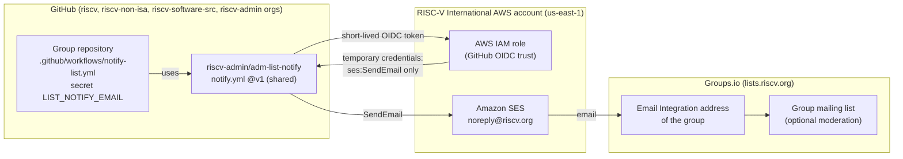
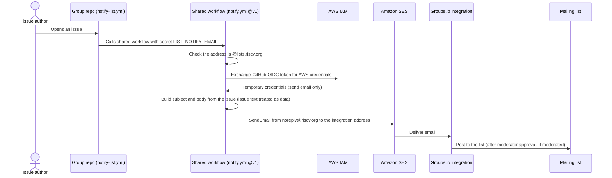

# adm-list-notify

Posts a message to a RISC-V Groups.io mailing list whenever a new issue is opened in a GitHub repository.
One shared workflow serves every group; each repository only needs a small caller file and one secret.

**Want this for your group?** Email [help@riscv.org](mailto:help@riscv.org) with the GitHub repository
and the mailing list. RISC-V staff do the setup.

## What the list receives

- **From:** `RISC-V GitHub` (shown by Groups.io as an *Integration* post)
- **Subject:** `[GITHUB ISSUE OPENED]: #<n>, <title>`
- **Body:** the issue title (linked to the issue), one line `#<n> in <repo> by @<author>` (repo and author
  linked), then the issue text. HTML with a plain-text alternative; long text is truncated.
- Only **newly opened issues**. Comments and edits stay on GitHub.

## Architecture



## Sequence



## Security

- **No stored keys.** The workflow gets short-lived AWS credentials through GitHub's OIDC token.
- **Least privilege.** The credentials can only send email from `noreply@riscv.org` to `@lists.riscv.org`
  addresses, and only RISC-V International workflows running this shared workflow can obtain them.
- **Untrusted input.** Issue title and text are HTML-escaped and handled as data; they are never run as code.
- **Secrets.** Each list's address is the repo secret `LIST_NOTIFY_EMAIL`; the AWS role is the organization
  secret `LIST_NOTIFY_AWS_ROLE`. The AWS configuration is kept privately by RISC-V staff.
- **Change control.** `main` and the release tags are protected. Maintainer: Rafael Sene (@rpsene).

## Setup for a new group (RISC-V staff)

Requests arrive at help@riscv.org with the repository and the list.

Prerequisite (once per GitHub org): the org secret `LIST_NOTIFY_AWS_ROLE` must exist. It is already set
in riscv, riscv-non-isa, riscv-software-src and riscv-admin; for any other org, ask the maintainer.

1. **Groups.io** (as group owner): *Admin → Integrations → + Email Integrations*. Create the receive-only
   address. Turn moderation on for the integration while the group gets used to it (optional).
2. **GitHub** (needs admin on the repo), from a clone of this repo:

   ```bash
   ./onboard.sh <owner>/<repo> <integration-address>@lists.riscv.org
   ```

   This sets the repo secret `LIST_NOTIFY_EMAIL` and opens a PR adding `.github/workflows/notify-list.yml`.
   Wait for the repo's checks and merge the PR.
3. **Test:** open an issue titled `Test: notifications (please ignore)`, check that it reaches the list
   (or the pending queue), then close the issue.
4. Reply to the requester on the help@ ticket.

To change the target list, re-run `onboard.sh` with the new address (it only updates the secret).
To stop notifications, delete `notify-list.yml` from the group's repo.

## Changing the shared workflow

Changes to `notify.yml` reach every connected repo. Callers pin `@v1`: move the `v1` tag only for
compatible changes, and publish `v2` for breaking ones. Test locally by running the `Send the email` step's
script against a sample event file with `aws sesv2` replaced by `echo`.
